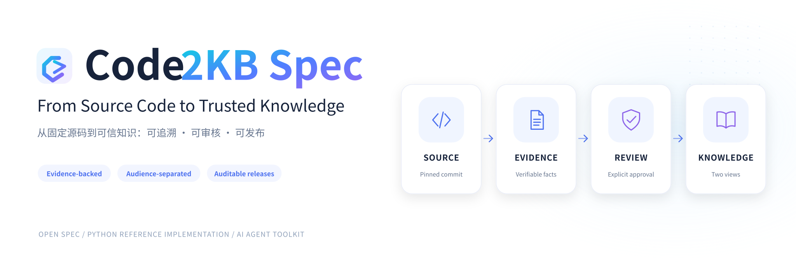
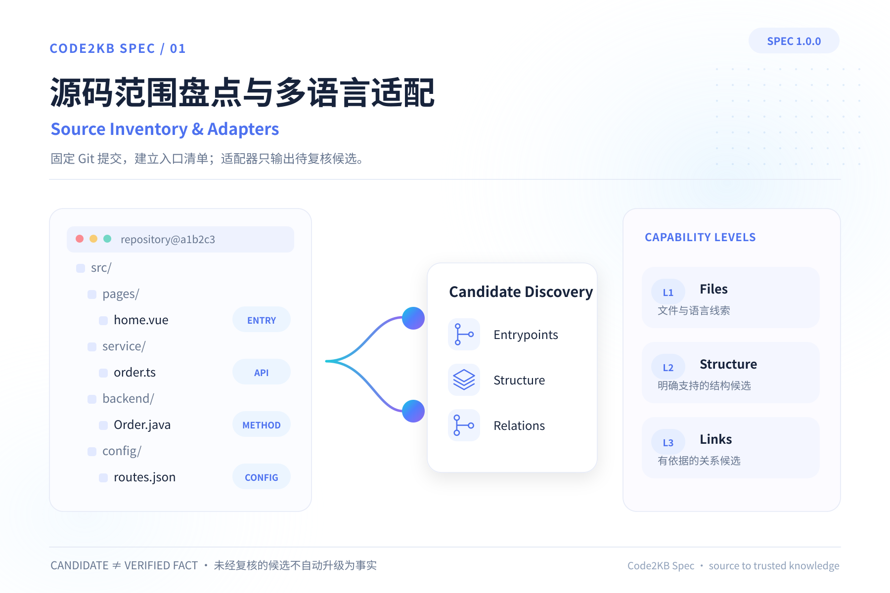
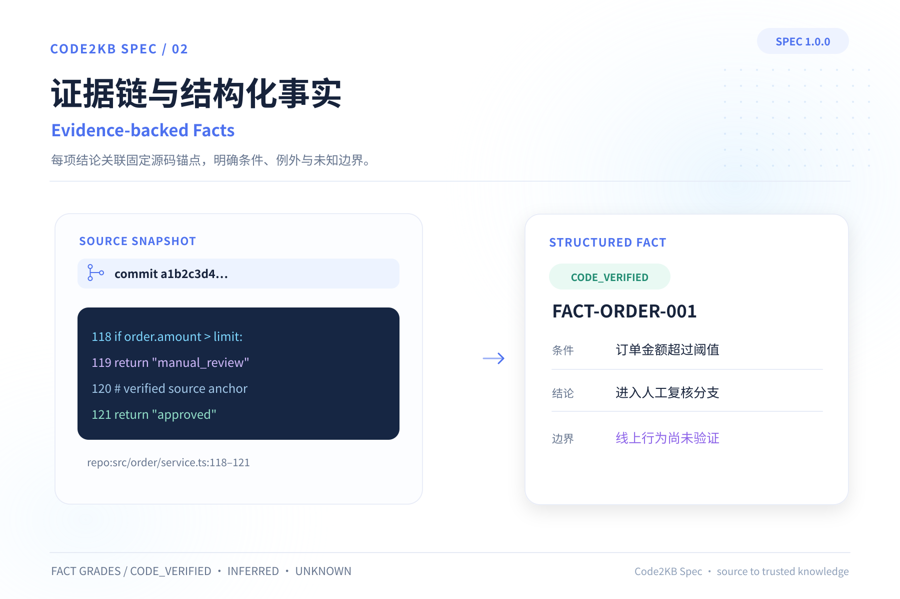
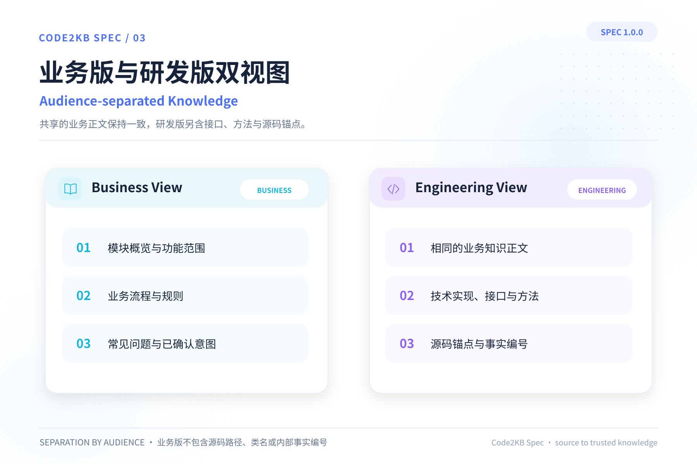
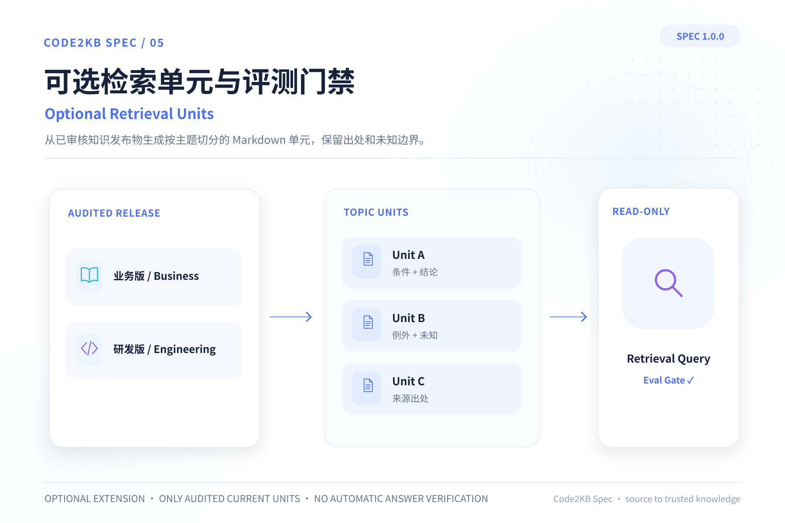
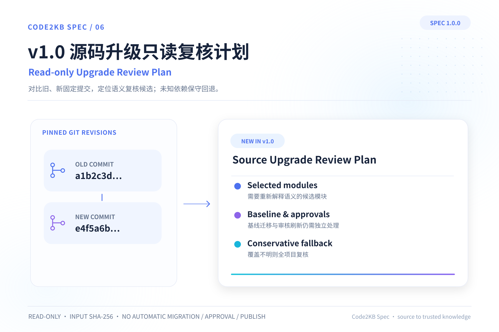

# Code2KB Spec

[简体中文](README.md) · **English**



Build **evidence-backed, reviewable, publishable** business and engineering knowledge bases from pinned source revisions.

Code2KB Spec provides a knowledge-file specification, an AI agent skill, templates, and Python reference tools. A coding agent reads source code and writes knowledge; the tools check files, evidence, and release state. It is intended for teams that need traceable knowledge across code repositories.

## Workflow and outputs

`Pinned Git revisions → Entry-point inventory → Module evidence and writing → Review → Two-view release`

| Output | Contents |
| --- | --- |
| Knowledge source | Functional outline, module specifications, business and engineering text, unresolved questions |
| Release | Separate business and engineering views, version manifest, and current-version pointer |
| Optional retrieval extension | Topic-sized retrieval units with an independent audit record |

For source upgrades, 1.0.0 can also produce a [read-only review plan](docs/1.0.0-public-contract.md) to locate knowledge that may need reinterpretation. It does not rewrite knowledge or approve releases.

<details>
<summary>View source evidence and two-view knowledge diagrams (3)</summary>

Code, filenames, and fact IDs in these diagrams are illustrative. The diagrams have Chinese labels with English subtitles.







</details>

<details>
<summary>View optional retrieval and source-upgrade review diagrams (2)</summary>

The retrieval extension uses reviewed release knowledge. The upgrade plan is read-only and does not migrate or approve content.





</details>

## Quick start

Requires **Git** and **Python 3.9+**. The bundled demo needs no source repository of your own:

```bash
git clone https://github.com/Ethereal-Space-one/code2kb-spec.git
cd code2kb-spec
python3 -B examples/create_demo.py
```

The command creates a small source repository and knowledge project in a temporary directory, runs `check`, and prints the project path. It demonstrates the file structure and validation workflow; it does not generate a complete knowledge base.

## Create a knowledge project

### 1. Install and pin source revisions

Keep the knowledge project separate from the source repositories. Start from the configuration template:

```bash
python3 -m pip install -e .
mkdir -p /path/to/knowledge-project
git init /path/to/knowledge-project
cp templates/知识库配置.example.json /path/to/knowledge-project/知识库配置.json
git -C /path/to/source-repo rev-parse HEAD
```

Edit `知识库配置.json`: remove unused example repositories, then set each `repositories` entry's `path` to an absolute local repository path and `commit` to its pinned commit SHA.

### 2. Inventory and write knowledge

Ask a coding agent to read the [Skill](skills/extract-app-knowledge/SKILL.md). First verify the configuration and pinned commits, then create `知识源/功能大纲.md` before extracting individual modules. For example:

```text
Read <code2kb-spec-root>/skills/extract-app-knowledge/SKILL.md.
The knowledge project is /path/to/knowledge-project. Verify its pinned source commits,
inventory all in-scope entry points, and create 知识源/功能大纲.md.
Record unknowns explicitly; do not present source-based inference as production behavior.
```

### 3. Check, review, and release

Run a structural check as the knowledge source takes shape:

```bash
code2kb check --project-root /path/to/knowledge-project
```

After module impact review, claim review, candidate preparation, and authorized approval, publish and audit:

**Choose a review path before approval:** use `approve` for an explicit decision by a human reviewer; use `policy-review` only when the project has a valid, preauthorized policy and a review record for this candidate. A package outside the policy or caught by a manual gate stays in draft for human review. The choice is per module; an agent self-check or passing `check` never approves a package.

```bash
code2kb publish --project-root /path/to/knowledge-project --release-id my-kb-v1
code2kb audit-release --project-root /path/to/knowledge-project
```

A passing `check` does not mean the knowledge is ready to publish. The [usage guide](docs/usage.md) covers `impact`, `confirm-claims`, `prepare`, and approval arguments.

## Documentation and support

- [Usage guide](docs/usage.md): full workflow and commands
- [Specification](SPEC.md): file, evidence, review, and release requirements
- [Retrieval extension](docs/retrieval-contract.md): optional retrieval units and external indexing boundary
- [Versioning](docs/versioning.md): project release, tool version, and file-protocol compatibility
- [Issues](https://github.com/Ethereal-Space-one/code2kb-spec/issues) · [Contributing](CONTRIBUTING.md) · [Changelog](CHANGELOG.md)

## Limitations

Source code alone cannot prove production behavior, business policy, or authorization outcomes. Unknowns remain explicit without runtime evidence. The project does not include domain knowledge, bot deployment, or a hosted search service.

Current project version: `1.0.0`. New projects default to the `c2kb-file/1` file protocol; existing `0.8.3` projects remain supported. The normative specification is in Simplified Chinese. Licensed under [Apache License 2.0](LICENSE).
